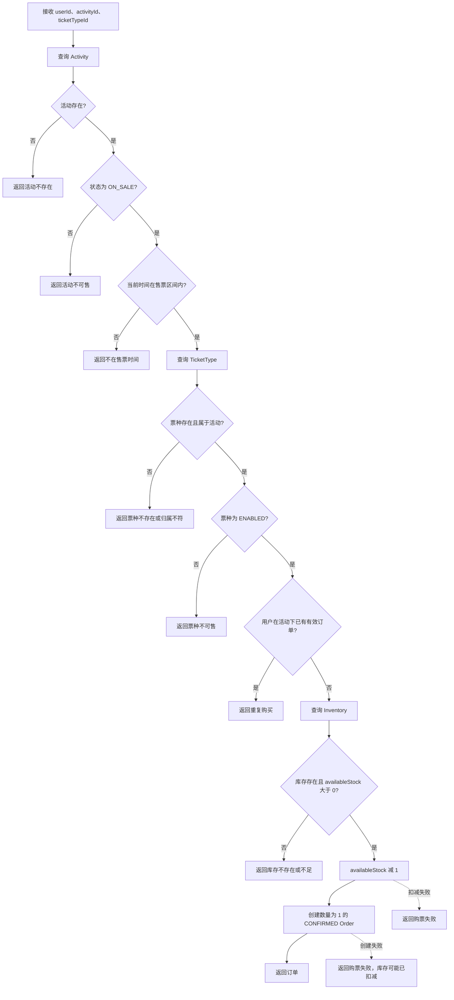

# 基础同步购票流程

第一版每次购买一张；同一用户对同一活动最多拥有一笔有效订单。PENDING、CONFIRMED 为有效订单，CANCELLED 不计入。订单金额取购买时的票种价格。此流程仅描述业务判断，不保证并发安全或步骤原子性。



```text
purchase(userId, activityId, ticketTypeId):
    activity = findActivity(activityId)
    if activity is absent: return ACTIVITY_NOT_FOUND
    if activity.status != ON_SALE: return ACTIVITY_NOT_ON_SALE
    if now < activity.saleStartTime or now > activity.saleEndTime:
        return OUTSIDE_SALE_PERIOD
    ticketType = findTicketType(ticketTypeId)
    if ticketType is absent: return TICKET_TYPE_NOT_FOUND
    if ticketType.activityId != activityId: return TICKET_TYPE_MISMATCH
    if ticketType.status != ENABLED: return TICKET_TYPE_DISABLED
    if hasOrder(userId, activityId, statuses=[PENDING, CONFIRMED]):
        return ALREADY_PURCHASED
    inventory = findInventory(ticketTypeId)
    if inventory is absent: return INVENTORY_NOT_FOUND
    if inventory.availableStock <= 0: return OUT_OF_STOCK
    inventory.availableStock = inventory.availableStock - 1
    if save(inventory) fails: return PURCHASE_FAILED
    order = createOrder(userId, activityId, ticketTypeId, quantity=1,
                        amount=ticketType.price, status=CONFIRMED, createdAt=now)
    if order creation fails: return PURCHASE_FAILED
    return order
```

售票时间两端均包含在内；状态和时间条件必须同时满足。查询或其他操作异常时返回购票失败；创建订单失败时库存可能已经扣减。用户身份有效性与认证暂不定义。

## 已知风险

- 检查有效订单与创建订单之间存在竞态，并发请求可能产生重复有效订单。
- 检查库存与扣减库存之间存在竞态，可能超卖或丢失更新。
- 扣减库存与创建订单之间存在一致性问题，订单创建失败或服务中断时库存可能已减少。

这些问题留待后续阶段研究，本流程不提供修复方案。
