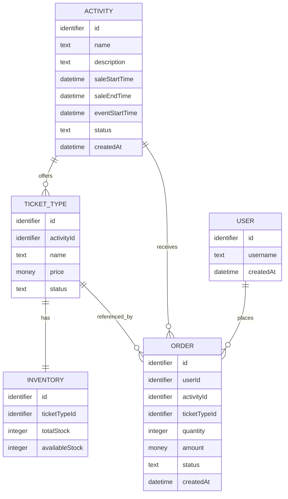

# 领域模型

以下是第一版概念模型，不代表最终数据库 Schema、字段类型或约束。一个 User 可有多个 Order；一个 Activity 可有多个 TicketType 和 Order；每个 TicketType 对应一个独立 Inventory，并可关联多个 Order。Order 的 activityId 必须与其 TicketType 的 activityId 一致。

Activity 状态为 DRAFT、ON_SALE、SALE_ENDED、CANCELLED；TicketType 状态为 ENABLED、DISABLED；Order 状态为 PENDING、CONFIRMED、CANCELLED。PENDING 为预留状态，第一版同步购票可直接创建 CONFIRMED 订单。状态转换和取消后的库存处理尚未定义。

第一版 quantity 固定为 1。订单金额记录购买时的交易金额，票种价格之后变化不改变已记录的订单金额。业务规则见 [05-business-rules.md](05-business-rules.md)。
